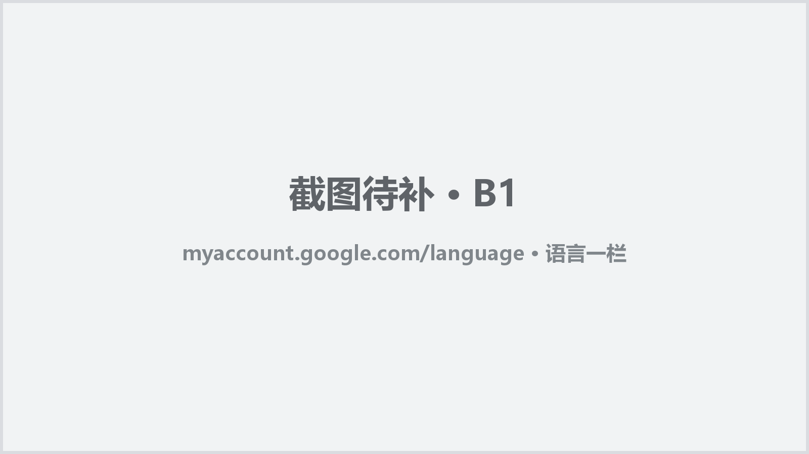
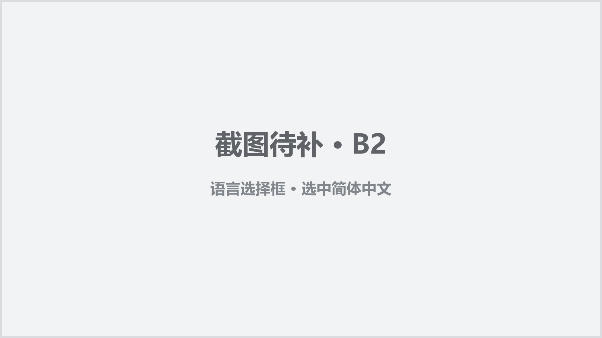

# 附录 B：把 Google 改成中文界面

💻 电脑 网址：[myaccount.google.com/language](https://myaccount.google.com/language)

开着土耳其节点时，Google 的页面有可能显示成土耳其语或英文。把账号的语言设为简体中文，所有 Google 网页（包括 Google Pay、Google Play、家庭组页面）都会显示中文，和本教程的截图一致。

1. 打开 [myaccount.google.com/language](https://myaccount.google.com/language)，登录你的账号。
2. 在"首选语言"（Preferred language）一栏，点 1 处的铅笔图标。

    { .shot }

3. 在搜索框里输入"中文"，选择 1 处的"中文（简体）"，地区选"中国"，然后点 2 处的"保存"（Save）。

    { .shot }

4. 刷新已经打开的 Google 页面，界面就会变成中文。

!!! tip "改了还是英文？"
    有些页面会跟随浏览器的语言。可以在浏览器设置里把"中文（简体）"移到语言列表的最上面，或者在网址末尾加上 `?hl=zh-CN` 再打开，例如 `https://pay.google.com/?hl=zh-CN`。

改好后，回到[首页](index.md)继续。
