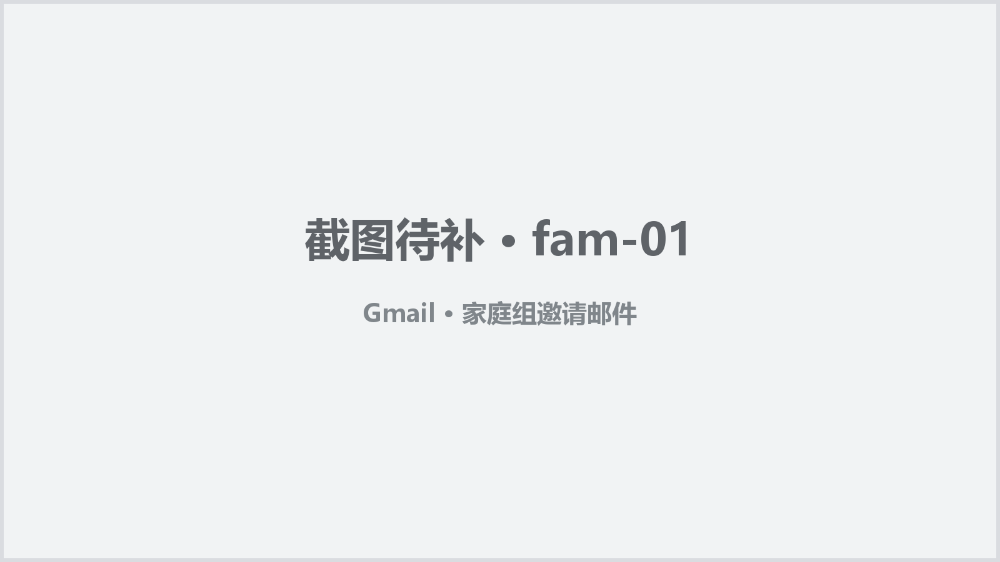
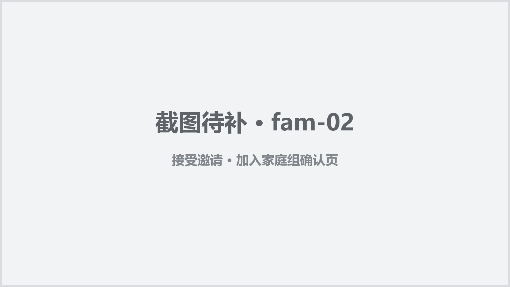
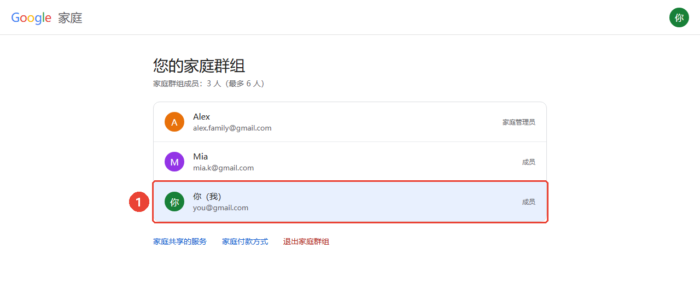

# 4. 加入家庭组

💻 电脑 网址：[families.google.com](https://families.google.com)

## 加入前必读 { #rules }

Google 对家庭组有几条硬规则，不满足的话，邀请会接受失败，或者加入后服务被停用：

1. **必须和管理员在同一个国家。** 管理员的家庭组是土区的，你的账号国家也必须是土耳其。所以一定要先完成[第 2 节](payments.md)和[第 3 节](play-country.md)，再接受邀请。如果账号里还留着其他国家的支付资料导致加入失败，按[第 3 节的情况二](play-country.md#fix)把它们关掉。
2. **同一时间只能在一个家庭组里。** 已经在别的家庭组里，要先退出。
3. **12 个月内只能换一次家庭组。** 从一个家庭组换到另一个，12 个月内只能换一次；退出后重新加入原来的家庭组不受限制。
4. **在家庭组里就不能改 Play 国家。** 以后想换国家，得先退出家庭组。
5. **必须是个人账号。** 工作或学校发的 Google 账号不能加入。

!!! note "关于 YouTube Premium 家庭方案"
    YouTube 官方要求家庭方案的成员和管理员住在同一住址，并且可能会不定期要求验证。如果你加入家庭组是为了 YouTube Premium，请了解这一点。

一个家庭组最多 6 人（1 名管理员加 5 名成员）。加入后可以共享的服务包括 YouTube Premium、Google One 存储空间、Google AI 方案、Google Play 家庭媒体库等，具体看管理员订阅了什么。

## 第一步：打开邀请邮件

管理员发出邀请后，你的 Gmail 会收到一封来自 Google 的家庭组邀请邮件。

1. 打开 [Gmail](https://mail.google.com)，找到标题类似"…邀请您加入家庭群组"的邮件。
2. 点邮件里 1 处的"接受邀请"（Accept invitation）。

{ .shot }

!!! tip "没收到邀请邮件？"
    先看看"垃圾邮件"和"推广"文件夹。还是没有的话，登录账号后直接打开 [families.google.com](https://families.google.com)，页面上会显示待接受的邀请。注意：Google 家庭组没有"谁拿到都能用"的公开邀请链接，邀请只认管理员填写的那个 Gmail 地址，所以要确认管理员没有把你的地址填错。

## 第二步：确认加入

1. 点开邀请后，会打开一个确认页，上面显示管理员的名字和家庭组信息。
2. 点 1 处的"加入家庭群组"（Join family group）。

{ .shot }

## 第三步：确认已经加入

打开 [families.google.com](https://families.google.com)，在成员列表里（1）能看到你自己，就说明加入成功了。

{ .shot }

!!! success "完成"
    现在你已经是这个土区家庭组的成员了。管理员订阅的共享服务一般几分钟内就会生效，比如打开 YouTube，头像旁边会出现 Premium 标志。

遇到问题？看 [5. 常见问题与报错](faq.md)。
