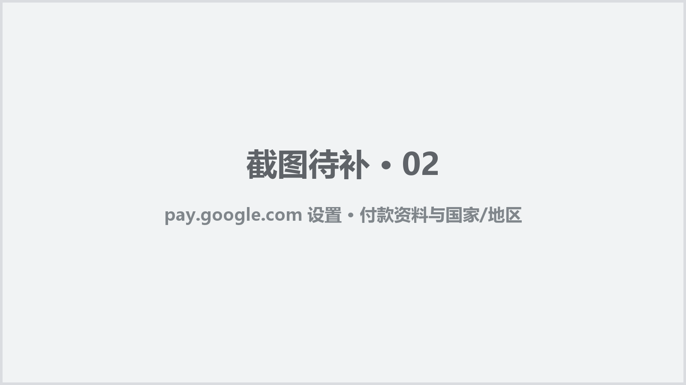
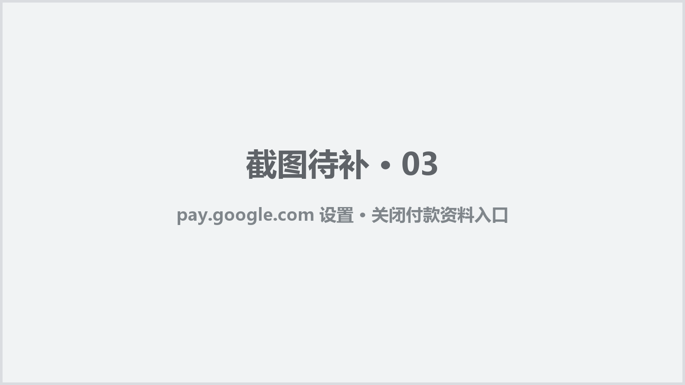
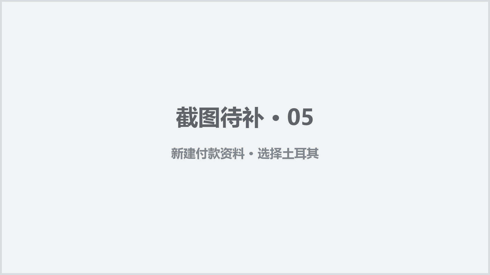
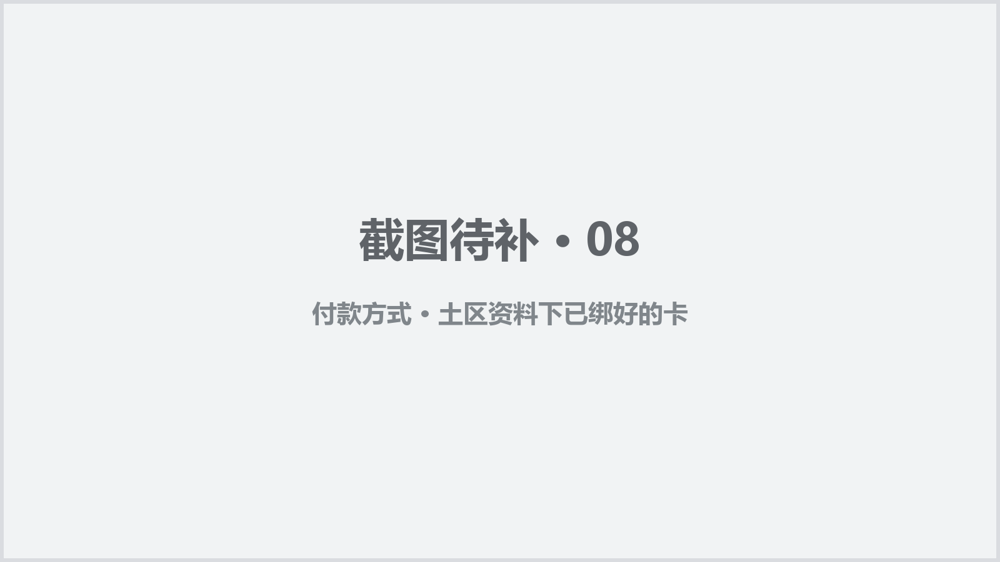

# 2. 建立土区支付资料

💻 电脑 网址：[pay.google.com](https://pay.google.com)

**支付资料**（Payments profile）是 Google 记录你"在哪个国家付钱"的档案，Google Play 的国家就是跟着它走的。一个支付资料的国家建好后不能修改，所以做法是：**先把旧的支付资料全部关掉，再新建一个土耳其的**。

!!! warning "关闭支付资料后不能恢复"
    关闭后，这份资料上的订阅、Google Play 余额和付款记录都会失效，而且**无法撤销**。如果你的旧资料里还有正在用的订阅或余额，请先处理完再继续。

## 第一步：查看现有的支付资料

1. 打开 [pay.google.com](https://pay.google.com)，点左侧（手机上在顶部菜单）的"设置"（Settings）。
2. 在 1 处的"付款资料"（Payments profile）区域，查看"国家/地区"（Country/Region）一栏显示的国家。
3. 如果页面顶部有一个可以下拉的资料名称（2），说明你有不止一份资料，点开它就能看到所有资料。

{ .shot }

如果"国家/地区"一栏已经是土耳其，而且只有这一份资料，可以直接跳到[第三步](#step3)绑卡。

!!! note "从来没用过 Google 支付？"
    如果打开后页面提示你还没有支付资料，说明你什么都不用关，直接跳到[第三步](#step3)。

## 第二步：关闭所有旧的支付资料

对**每一份**不是土耳其的资料，都重复下面的操作：

1. 在页面顶部切换到要关闭的那份资料。
2. 在"设置"页面拉到最底部，点 1 处的"关闭付款资料"（Close payments profile）。

    { .shot }

3. 在弹出的对话框里选择一个关闭原因，然后点 1 处的"关闭资料"确认。

    { .shot }

全部关完后，刷新页面，应该显示你没有任何支付资料。

## 第三步：新建土耳其支付资料并绑卡 { #step3 }

1. 在 pay.google.com 点"付款方式"（Payment methods），再点"添加付款方式"（Add payment method）。因为现在没有任何资料，Google 会先让你建一份新资料。
2. 在 1 处的"国家/地区"下拉框里选择**土耳其（Türkiye）**。

    { .shot }

3. 填写姓名和账单地址，具体每一栏怎么填，见下面的[账单地址怎么填](#address)。填好后**先别急着提交**，核对一遍：省、市要对得上，邮编是 5 位数字。

    { .shot }

4. 在卡号表单里填入虚拟卡的卡号（1）、有效期（2）和安全码 CVC（3），然后点"保存"（Save）。

    { .shot }

5. 回到"付款方式"页面，确认土耳其资料下已经出现这张卡（1）。

    { .shot }

!!! tip "绑卡时 Google 会扣一笔小钱"
    为了验证卡是否有效，Google 可能会扣一笔很小的金额（通常几里拉或不到 1 美元），之后会自动退回。卡里没有余额就会绑定失败，所以请提前留几美元。

## 账单地址怎么填 { #address }

账单地址不需要是你的真实住址，只要是一个**格式正确的土耳其地址**就行。在搜索引擎里搜"**土耳其地址生成器**"（或 Turkey address generator），随便打开一个，生成一条地址，然后按下表对应填写：

| 表单栏位 | 土耳其语叫法 | 填什么 | 示例格式 |
|---|---|---|---|
| 姓名 | Ad Soyad | 你的名字拼音即可 | Zhang San |
| 地址第 1 行 | Adres | 街道、门牌号 | Atatürk Cd. No:12 |
| 城市 / 区 | İlçe | 区（县）名 | Kadıköy |
| 省 | İl | 省名，要和区对得上 | İstanbul |
| 邮编 | Posta Kodu | 5 位数字 | 34710 |
| 电话 | Telefon | 选填，可以留空 | |

!!! note "其他地区"
    如果你要加入的是其他国家的家庭组，做法完全一样，只是第三步选那个国家，并搜索对应国家的地址生成器。

绑好卡后，继续 [3. 确认 Play 国家已切换](play-country.md)。
