# 2. 建立土区支付资料

💻 电脑 起点：[google.com](https://www.google.com)

**支付资料**（Payments profile）是 Google 记录你"在哪个国家付钱"的档案，Google Play 的国家就是跟着它走的。一份支付资料建好后，国家不能直接修改，所以要**新建一份土耳其的支付资料**，再在里面绑上虚拟卡。

!!! info "不会影响你现有的服务"
    新建支付资料时，Google 会提示："创建新的支付资料不会影响您当前的服务，相应的服务费用将继续使用当前的支付资料支付。"所以你原来的订阅和付款方式都不会被删掉。

## 第一步：进入 Google 付款中心

1. 打开 [google.com](https://www.google.com)，点右上角的头像 1，在弹出的菜单里点"管理您的 Google 账号"2。

    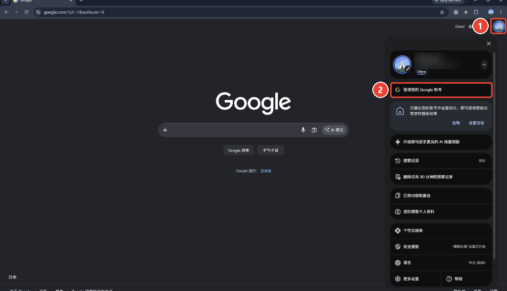{ .shot }

2. 在左侧菜单里点"钱包和订阅"1。

    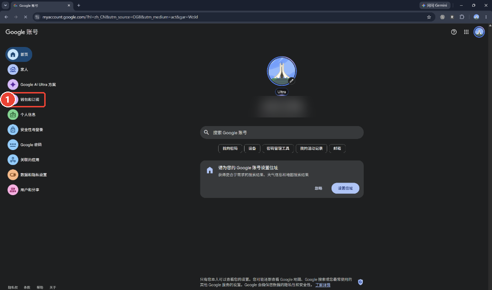{ .shot }

3. 点"管理付款方式"1。

    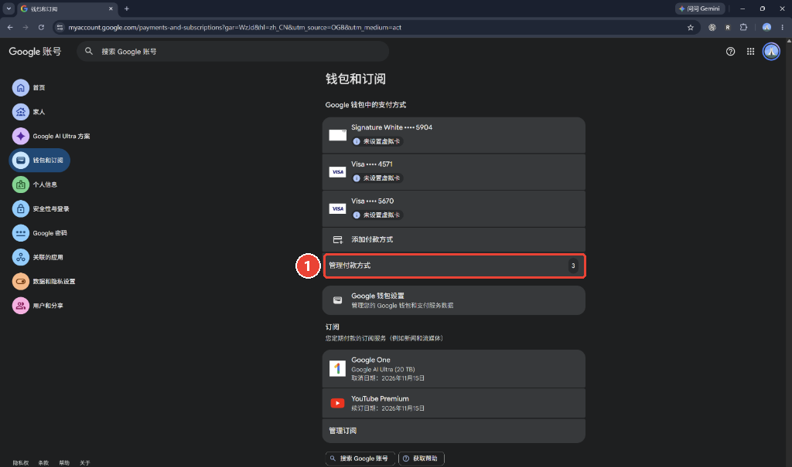{ .shot }

4. 在页面最下方，点蓝色的"Google 支付中心"链接 1。

    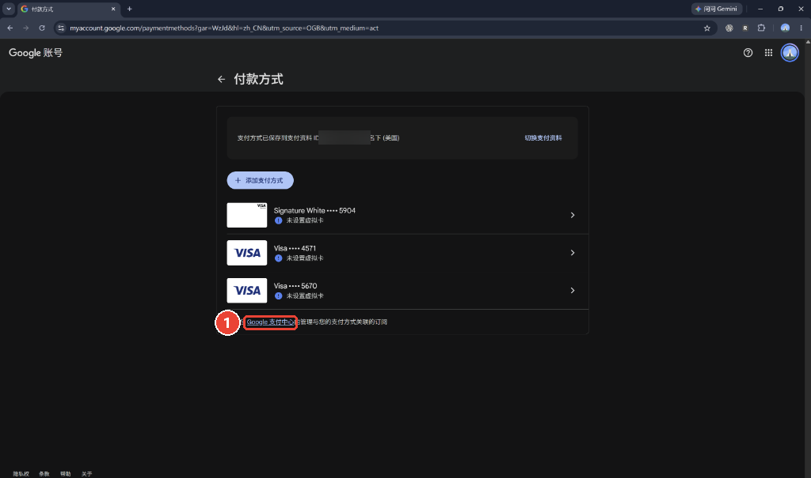{ .shot }

5. 进入 Google 付款中心后，点顶部的"设置"1。

    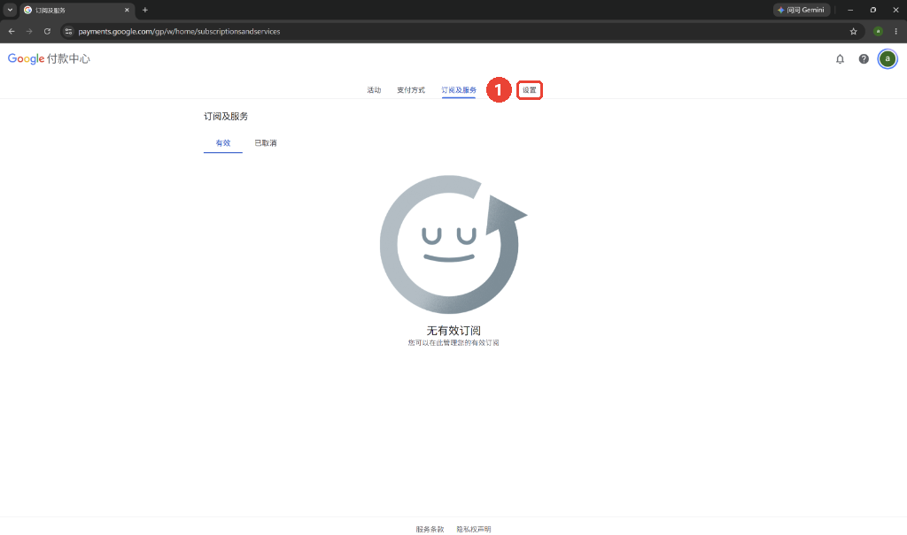{ .shot }

!!! tip "捷径"
    熟悉之后，可以直接打开 [payments.google.com/gp/w/home/settings](https://payments.google.com/gp/w/home/settings)，一步跳到付款中心的设置页。

## 第二步：新建土耳其支付资料

1. 在"支付资料"区域，点"国家/地区"旁边的铅笔图标 1。

    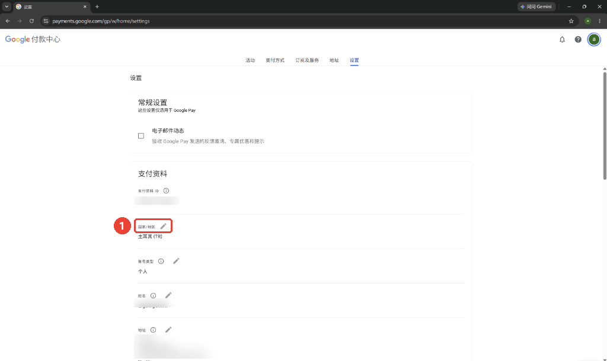{ .shot }

    !!! note "没有铅笔图标？"
        有的账号在国家下面显示的是蓝色的"新建个人资料"链接 1，点它，效果一样。

        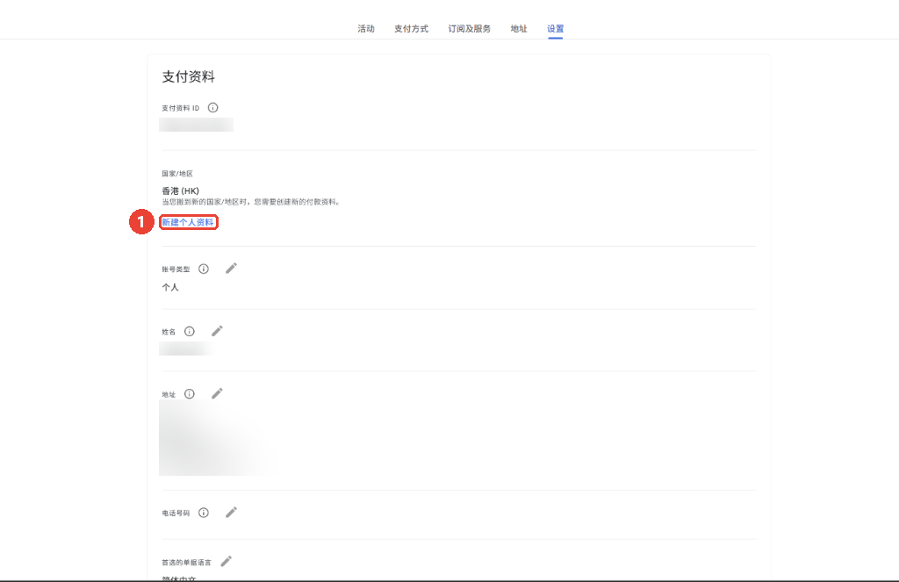{ .shot }

2. 弹出"创建新的支付资料"的说明，点"继续"1。

    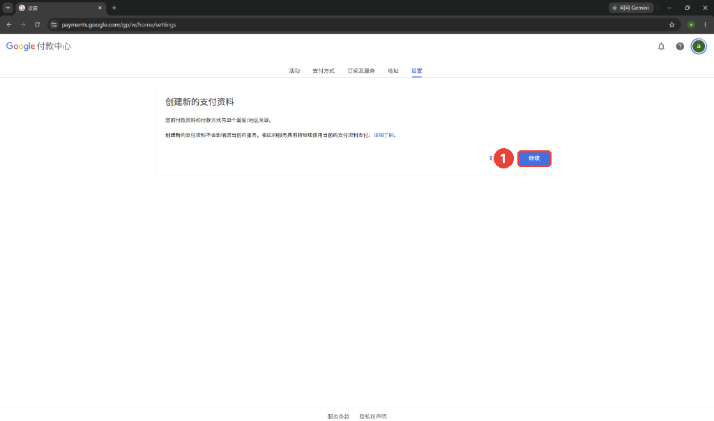{ .shot }

3. 在"国家/地区"列表 1 里找到并选择**土耳其 (TR)**。列表很长，可以直接用键盘输入"土"快速跳转。

    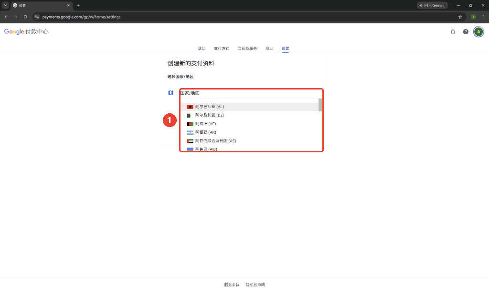{ .shot }

4. 接下来填写姓名和地址。姓名填你名字的拼音即可，地址怎么填看下一步。

## 第三步：填写土耳其地址 { #address }

账单地址不需要是你的真实住址，只要是一个**格式正确的土耳其地址**就行。

**先生成一个地址**：在搜索引擎里搜"**土耳其地址生成器**"，随便打开一个，它会随机生成一套土耳其的身份信息，我们只需要其中的街道、城市和邮编。下图是一个生成结果的示例：

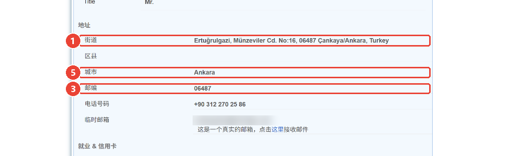{ .shot }

**再对照填进 Google 的表单**：两张图上的编号是一一对应的，照着抄就行。

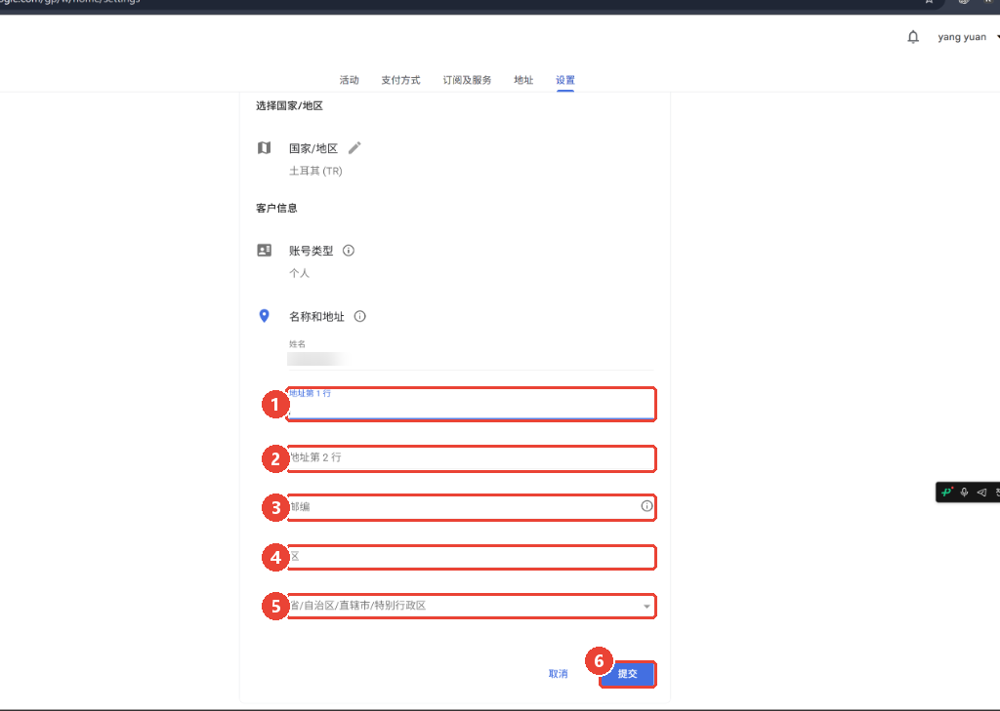{ .shot }

| 编号 | Google 表单里的栏位 | 从生成器里抄什么 | 示例 |
|:-:|---|---|---|
| 1 | 地址第 1 行 | "街道"一整行，直接复制粘贴 | Ertuğrulgazi, Münzeviler Cd. No:16, 06487 Çankaya/Ankara, Turkey |
| 2 | 地址第 2 行 | 不用填，留空 | |
| 3 | 邮编 | "邮编"，5 位数字 | 06487 |
| 4 | 区 | 街道那一行里，斜杠 `/` **前面**的那个地名 | Çankaya |
| 5 | 省/自治区/直辖市/特别行政区 | 下拉选择"城市"那一栏的地名 | Ankara |

填好后，点"提交"6。

!!! tip "生成器里的其他信息不用管"
    生成器还会给出名字、电话、临时邮箱、信用卡等信息，这些都**不要**填进 Google。电话一栏在 Google 表单里是选填的，留空即可。

## 第四步：确认资料已建好

1. 提交后看到"已创建新的支付资料"，点"查看支付资料"1。

    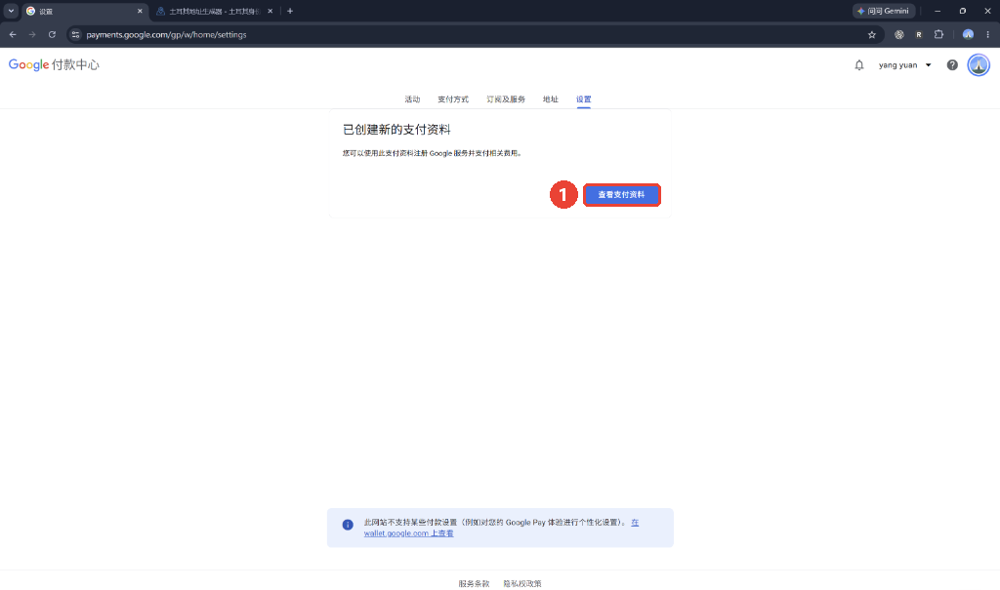{ .shot }

2. 页面上的地址 1 显示为土耳其，就说明土区支付资料建好了。

    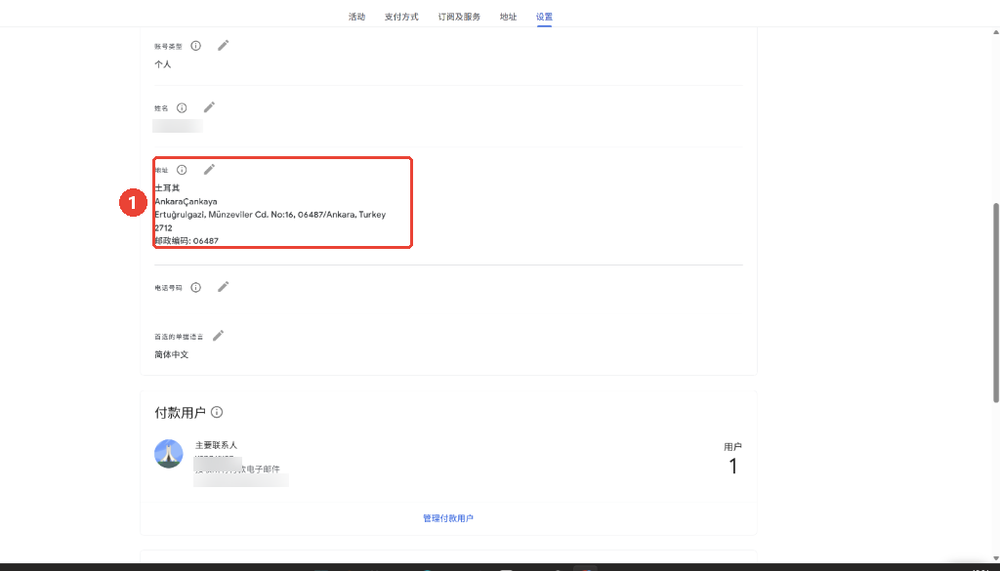{ .shot }

## 第五步：绑定虚拟卡 { #card }

1. 点顶部的"支付方式"，再点"添加支付方式"1。

    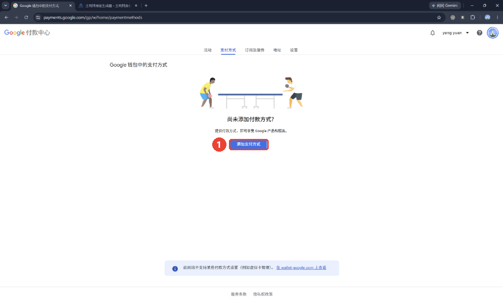{ .shot }

2. 在弹出的表单里，依次填入虚拟卡的**卡号** 1、**有效期** 2（月/年，例如 08/29）和**安全码 CVC/CVV** 3（虚拟卡详情页里的 3 位数字），持卡人姓名填拼音，然后点"保存" 4。账单地址会自动带出刚才填的土耳其地址。

    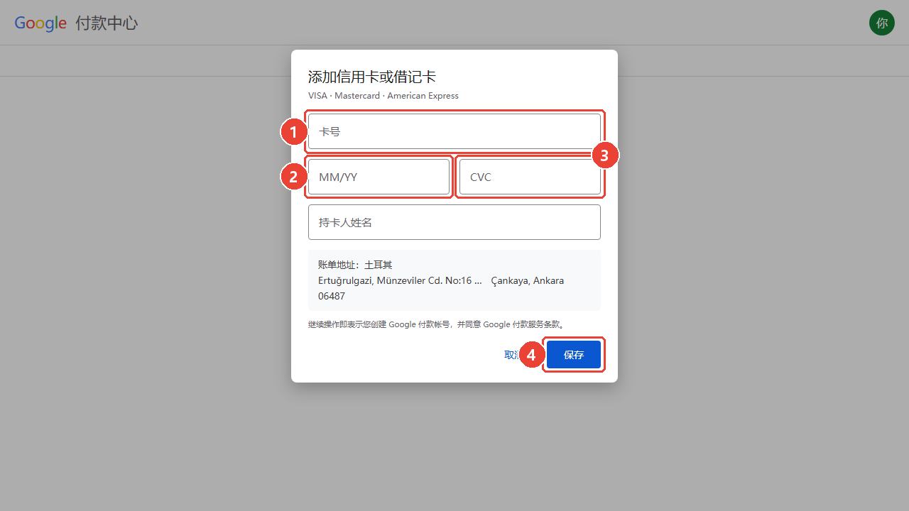{ .shot }
3. 回到"支付方式"页面，看到这张卡出现在列表里，绑卡就完成了。

!!! tip "绑卡时 Google 会扣一笔小钱"
    为了验证卡是否有效，Google 可能会扣一笔很小的金额，之后会自动退回。卡里没有余额就会绑定失败，所以请提前留几美元。还没有虚拟卡？看[附录 A](appendix-card.md)。

!!! note "其他地区"
    如果你要加入的是其他国家的家庭组，做法完全一样：第二步选那个国家，第三步搜索对应国家的地址生成器。

绑好卡后，继续 [3. 确认 Play 国家已切换](play-country.md)。
