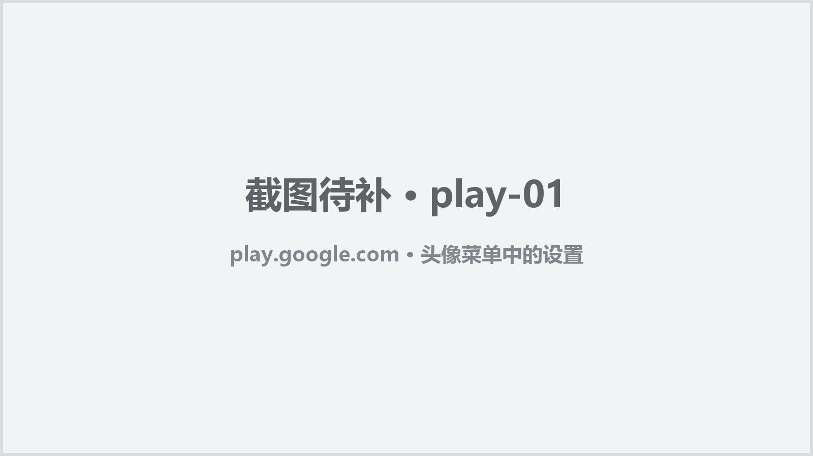

# 3. 确认 Play 国家已切换

💻 电脑 网址：[play.google.com](https://play.google.com)

建好土耳其支付资料后，Google Play 的国家通常会自动跟着变成土耳其。这一节只是确认一下。

## 查看 Play 国家

1. 打开 [play.google.com](https://play.google.com)，点右上角你的头像，在菜单里点 1 处的"设置"（Settings）。

    { .shot }

2. 在"常规"（General）下面找到"国家/地区和个人资料"（Country and profiles），看 1 处显示的国家：
    - 显示**土耳其**：大功告成，进入下一节。
    - 还是旧的国家：看下面的排查方法。

    { .shot }

## 国家没变怎么办 { #fix }

按顺序检查：

1. **等一会儿再看。** Google 官方说明，国家变更最长需要 48 小时才能生效。可以先关掉页面，过一段时间再看。
2. **确认节点是土耳其。** 刷新页面前确认节点没有掉线，也没有自动切换到其他地区。
3. **手动切换。** 如果"国家/地区和个人资料"下面列出了土耳其的选项，直接点它，按提示选择刚才绑好的那张卡。
4. **检查是否在家庭组里。** 家庭组成员不能改 Play 国家，如果你还在旧的家庭组里，先回到[准备工作](prepare.md)退出。
5. **检查冷却期。** Google 规定 Play 国家两次更改之间至少隔 90 天。如果你最近刚改过，只能等冷却期过去。

!!! info "手机上的 Play 商店 App"
    也可以在安卓手机的 Play 商店 App 里看：点右上角头像 → 设置 → 常规 → 帐号和设备偏好设置 → 国家/地区和个人资料。

国家确认是土耳其后，继续 [4. 加入家庭组](family.md)。
