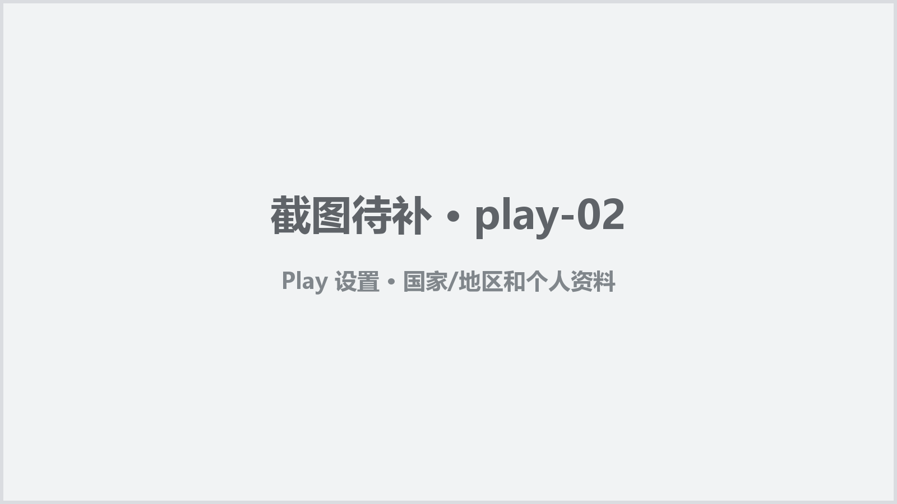
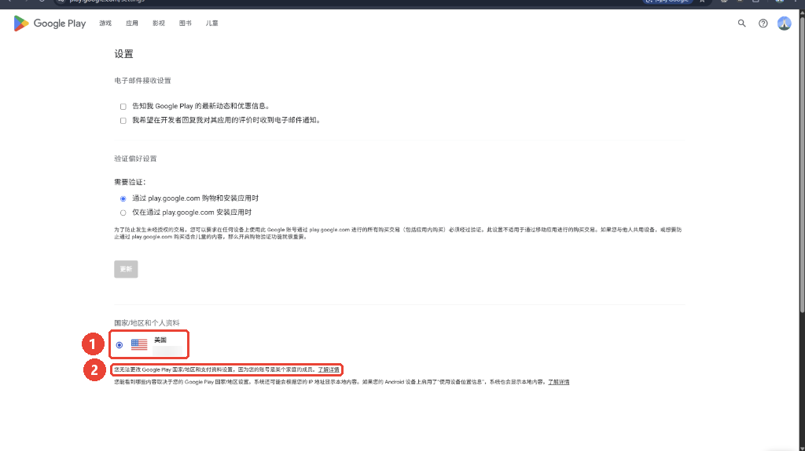
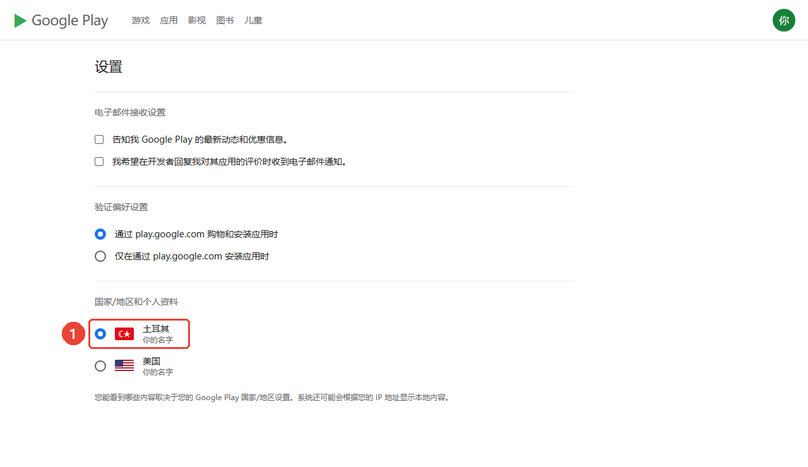
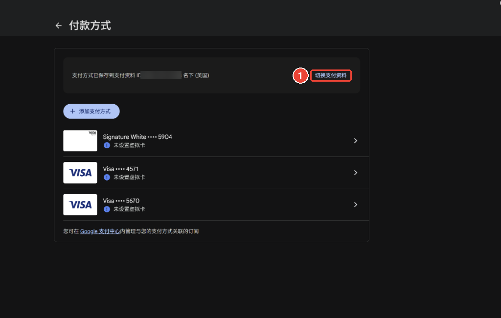
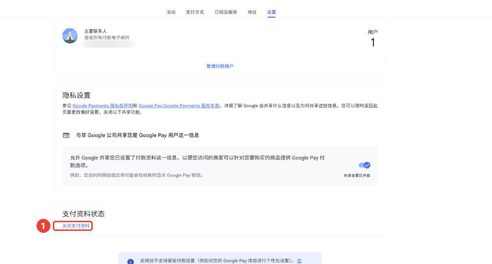
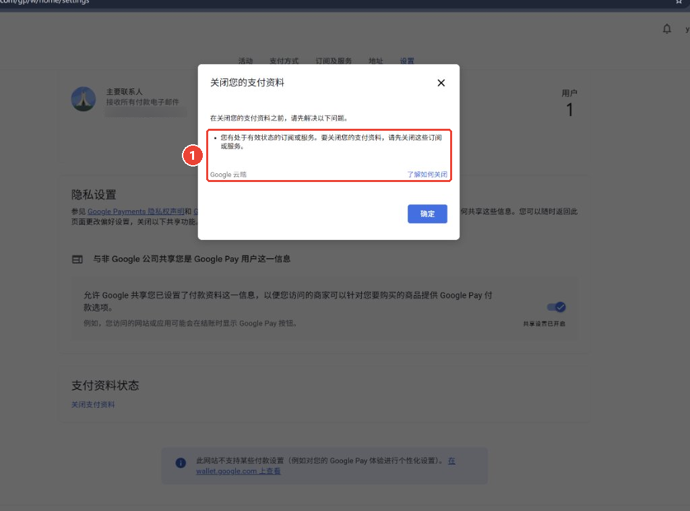

# 3. 确认 Play 国家已切换

💻 电脑 网址：[play.google.com](https://play.google.com)

建好土耳其支付资料后，到 Google Play 的设置里把国家改成土耳其。

## 修改 Play 国家

1. 打开 [play.google.com](https://play.google.com)，点右上角的头像 1。如果头像是灰色的小人，说明还没登录，先登录你的 Google 账号。

    { .shot }

2. 在弹出的菜单里点"设置"1。

    { .shot }

3. 把设置页拉到最下方，找到"国家/地区和个人资料"1。这里会列出你可以使用的国家：
    - 已经显示并选中**土耳其**：说明国家已经自动切过去了，直接进入[下一节](family.md)。
    - 列表里有土耳其，但没选中：点选土耳其，按页面提示确认即可。
    - 改不了，或者列表里没有土耳其：看下面的[改不了怎么办](#fix)。

    { .shot }

    改好之后，土耳其会出现在列表里并被选中 1，像下面这样：

    { .shot }

!!! note "上图是一个改不了的例子"
    上图只列出了"美国"，而且下方有一行提示 2："您无法更改 Google Play 国家/地区和支付资料设置，因为您的账号是某个家庭组的成员。"这就属于下面的情况一。

## 改不了怎么办 { #fix }

### 情况一：提示"因为您的账号是某个家庭组的成员"

家庭组成员不能改 Play 国家。按[准备工作](prepare.md)里的方法先退出当前的家庭组，再回来修改。

### 情况二：其他原因改不了

最常见的原因是：你的账号里**除了土耳其，还有其他国家的支付资料**，Google 不知道该用哪一个。解决办法是把土耳其以外的支付资料全部关掉。

!!! warning "关闭支付资料后不能恢复"
    关闭后，这份资料上的付款方式、Google Play 余额和付款记录都会失效，而且**无法撤销**。请确认要关的那份资料里没有你还需要的东西。

1. 回到第 2 节里那个黑色的"付款方式"页面（google.com 头像 → 管理您的 Google 账号 → 钱包和订阅 → 管理付款方式），点右上角的"切换支付资料"1，选择一份**不是土耳其**的资料。

    { .shot }

2. 点页面最下方的"Google 支付中心"，进入付款中心后点"设置"，然后把页面拉到最底部，在"支付资料状态"下面点"关闭支付资料"1。按提示确认后，这份资料就关掉了。

    { .shot }

3. 如果弹出"在关闭您的支付资料之前，请先解决以下问题"1，说明这份资料上还挂着正在生效的订阅或服务，比如 Google One、YouTube Premium、Google 云端。先把它们取消（付款中心顶部的"订阅及服务"里能看到），再回来关闭。

    { .shot }

4. 对每一份不是土耳其的资料都重复第 1–3 步，直到只剩下土耳其这一份。
5. 回到 Play 设置页，重新看"国家/地区和个人资料"，这时就能选土耳其了。

!!! tip "其他排查"
    - **等一等**：Google 官方说明，国家变更最长需要 48 小时才能生效。
    - **检查节点**：确认全程使用的是土耳其节点，没有掉线，也没有自动切换到别的地区。
    - **冷却期**：Play 国家两次更改之间至少隔 90 天。如果最近刚改过，只能等冷却期过去。

!!! info "手机上的 Play 商店 App"
    安卓手机的 Play 商店 App 里也能看：点右上角头像 → 设置 → 常规 → 帐号和设备偏好设置 → 国家/地区和个人资料。

国家确认是土耳其后，继续 [4. 加入家庭组](family.md)。
