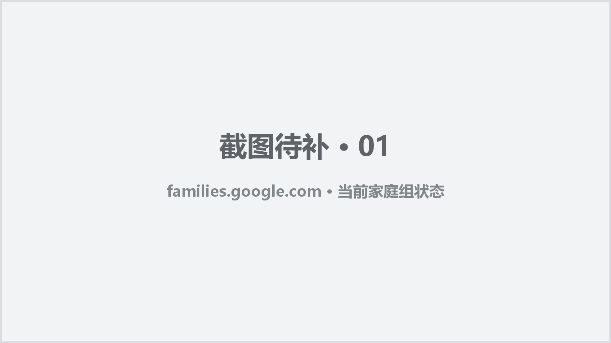

# 1. 准备工作

💻 电脑 这一节只做检查，不改任何设置。

## 需要准备的东西

| 东西 | 要求 | 没有怎么办 |
|---|---|---|
| 土耳其节点 | 全程开启，不要中途切换 | 先准备好再开始 |
| 一个 Google 账号 | **个人账号**（@gmail.com），工作或学校账号不能加入家庭组 | 注册一个新的 Gmail |
| 一张虚拟卡 | 能在海外网站绑定，卡里留几美元余额，用于 Google 的小额验证扣款 | 看[附录 A](appendix-card.md)，或找人代办 |
| 管理员的邀请 | 家庭组管理员已经知道你的 Gmail 地址，准备给你发邀请 | 先把 Gmail 地址发给管理员 |

## 检查自己是否已在别的家庭组里

一个账号同时只能在一个家庭组里。已经在别的家庭组里的话，要先退出，才能加入新的。

1. 打开 [families.google.com](https://families.google.com)，登录你的账号。
2. 看页面显示的内容：
    - 显示"创建家庭群组"之类的入口：说明你**不在**任何家庭组里，直接进入下一节。
    - 显示一个家庭组和成员列表：说明你**已经在**一个家庭组里，点 1 处的"退出家庭群组"（Leave family group）退出。

{ .shot }

!!! warning "退出前先想清楚"
    Google 规定：**12 个月内只能换一次家庭组**（退出后重新加入原来的家庭组不受限制）。如果你过去 12 个月里刚换过，现在退出后，短时间内可能无法加入新的家庭组。详见 [4. 加入家庭组](family.md#rules)。

准备就绪，继续 [2. 建立土区支付资料](payments.md)。
